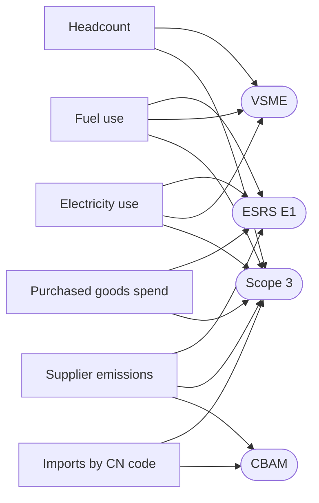

# F3 One dataset, many reports

!!! warning "Not legal advice"
    This page is a planning map. It shows which data usually feeds which
    report. Each track page gives the exact requirement and its source.

## In one sentence

Collect each core dataset once, in one place and one unit, and reuse it
for CBAM, Scope 3, VSME and ESRS E1, instead of answering the same
question four times.

## Who does this and when

The sustainability lead or finance lead who coordinates reporting. Do it
**before** the first report, when you decide who collects what. Review it
once a year, or when a new report or customer request arrives.

## Inputs

- The list of reports and requests you expect this year (see
  [T1 Which regime applies to me?](../start-here/triage.md)).
- Who in the company already holds each kind of data: finance,
  procurement, HR, facilities, the customs broker.

## Steps

1. Read the reuse map below. Mark the reports that apply to you.
2. For each dataset you need, name one **owner** and write down the
   **unit** and **frequency**. Use the data dictionary below as a start.
3. Collect each dataset once, in that unit, into the
   [evidence locker](evidence-locker.md). Hash the source files.
4. Build each report from the locker, never from a copy in someone's
   inbox.
5. When a number changes (a corrected invoice, new supplier data), change
   it once in the locker. Every report that uses it picks up the change.

### Reuse map

Six core datasets feed four reports. Arrows show where each dataset is
used.

### Data dictionary

This table is generated from
[`data/datasets.yml`](https://github.com/mantas123456/esg-workflows-handbook/blob/main/data/datasets.yml).
To change it, edit that file and run `python scripts/build_pages.py`.

<!-- generated from data/datasets.yml: do not edit by hand -->
| Dataset | Unit | Owner | Frequency | CBAM | Scope 3 | VSME | ESRS E1 | Notes |
|---|---|---|---|---|---|---|---|---|
| **Electricity use** (`electricity_use`) | MWh | Facilities or finance | Monthly (invoices or meter readings) |  | ✓ | ✓ | ✓ | Your own Scope 2 emissions. Scope 3 uses it for the upstream part of energy (category 3). Not used for CBAM, which needs the producer's data, not the importer's. |
| **Fuel use** (`fuel_use`) | litres or m³, by fuel type | Facilities or fleet manager | Monthly |  | ✓ | ✓ | ✓ | Your own Scope 1 emissions. Scope 3 uses it for the upstream part of fuels (category 3). |
| **Purchased goods and services spend** (`purchased_goods_spend`) | EUR, by spend category | Procurement or finance | Annual (from monthly ledger extracts) |  | ✓ |  | ✓ | Spend-based method for Scope 3 category 1. ESRS E1 includes significant Scope 3 categories. |
| **Supplier emissions data** (`supplier_emissions`) | tCO2e per tonne of product, or tCO2e per year | Procurement with the sustainability lead | Annual, per supplier | ✓ | ✓ |  | ✓ | For CBAM, embedded emissions from the installation operator. For Scope 3, supplier-specific data that replaces spend-based estimates. |
| **Imports by CN code** (`imports_by_cn_code`) | tonnes net mass, by CN code and country of origin | Customs broker or logistics | Per shipment, totalled per year | ✓ | ✓ |  |  | CBAM 50-tonne test and declaration. Scope 3 uses the mass for average-data estimates (category 1) and transport (category 4). |
| **Headcount** (`headcount`) | average number of employees, previous financial year | HR | Annual (from monthly payroll) |  | ✓ | ✓ |  | Scope 3 employee commuting (category 7). VSME general information. Also the CSRD 1,000-employee tests in T1. |
<!-- end generated datasets -->

## Worked example

Melita Metals Ltd is a fictional steel importer in Malta. It files a CBAM
declaration, prepares a VSME report for its bank, and answers Scope 3
requests from a large customer.

Without a plan, three people collect overlapping data for three reports.
With the reuse map, Melita Metals:

- names **6** datasets and one owner for each;
- collects each dataset once into the evidence locker;
- uses those 6 datasets in **15** places across the four reports (count
  the ticks in the table above).

Two examples of reuse:

- **Imports by CN code.** The customs broker sends one yearly extract by
  CN code. Melita Metals uses it for the CBAM 50-tonne test and
  declaration, and the same tonnes go into its average-data estimate for
  Scope 3 category 1.
- **Supplier emissions.** The steel mill sends emissions data per tonne of
  product. Melita Metals uses it as embedded emissions for CBAM, and the
  same data replaces a spend-based estimate in its Scope 3 inventory, after
  two adjustments: it adds the electricity emissions CBAM leaves out for
  steel, and it takes the mark-up off any default value
  ([C5](../csrd/c5-climate.md)).

## Common mistakes

- Using different units in different reports (kWh in one, MWh in
  another). Pick one unit per dataset and convert only at the end.
- Letting each report owner collect their own copy. Copies drift apart.
- Assuming your own electricity use is CBAM data. For an importer, CBAM
  needs the **producer's** emissions data from the installation abroad.
- Spreading supplier requests across teams. Send each supplier one
  request that covers CBAM and Scope 3 together.
- Treating the map as a list of legal requirements. It is a planning
  aid. Check the exact datapoints on each track page.

## Evidence to keep

- The data dictionary you agreed (owner, unit, frequency for each
  dataset), dated.
- For each reported number, a row in `reported_values.csv` that points to
  the same source files. See [F1](evidence-locker.md).

## Templates and tools

- [`data/datasets.yml`](https://github.com/mantas123456/esg-workflows-handbook/blob/main/data/datasets.yml):
  the data dictionary behind the table above. Copy it as a start for your
  own.
- [F1 Evidence locker](evidence-locker.md) and
  [`scripts/hash_evidence.py`](https://github.com/mantas123456/esg-workflows-handbook/blob/main/scripts/hash_evidence.py)
  for storing and hashing the source files.

## Reuse in other reports

This whole page is about reuse. Each track page links back here and
shows which datasets it needs.

## Sources

- Regulation (EU) 2023/956 (CBAM), consolidated text:
  [EUR-Lex](https://eur-lex.europa.eu/eli/reg/2023/956/2025-10-20)
- Commission Delegated Regulation (EU) 2026/1563 (revised ESRS, including
  E1 Climate change):
  [EUR-Lex](https://eur-lex.europa.eu/legal-content/EN/TXT/?uri=OJ%3AL_202601563)
- European Commission, voluntary standard (VSME), 3 July 2026:
  [finance.ec.europa.eu](https://finance.ec.europa.eu/news/commission-adopts-revised-sustainability-reporting-standards-2026-07-03_en)
- GHG Protocol, Corporate Value Chain (Scope 3) Standard, for the Scope 3
  category numbers (cited, not copied):
  [ghgprotocol.org](https://ghgprotocol.org/corporate-value-chain-scope-3-standard)
