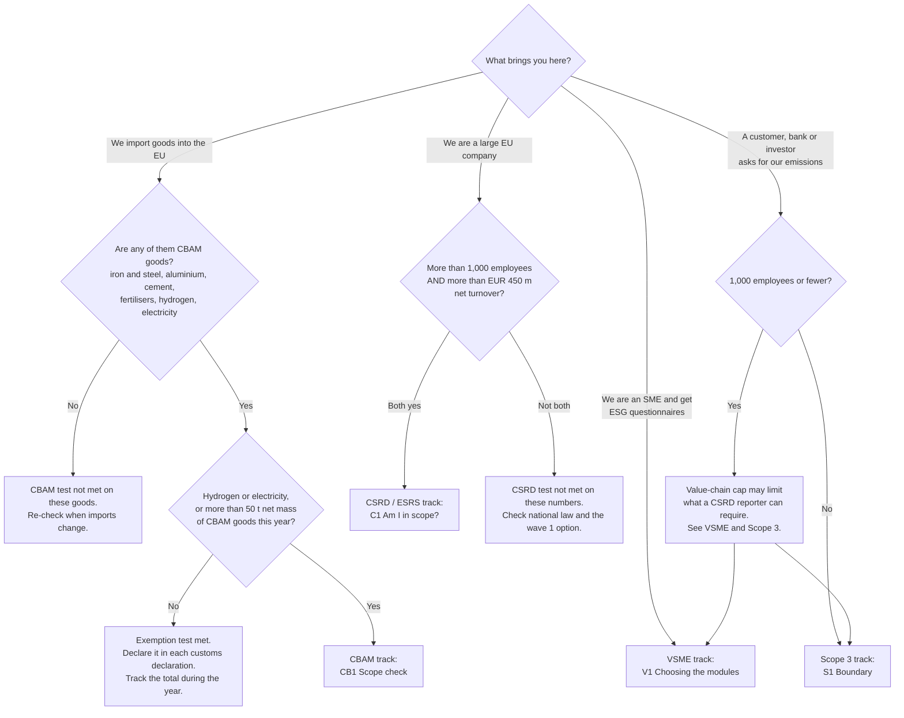

# T1 Which regime applies to me?

!!! warning "Not legal advice"
    This page shows each legal test and its source. It does not decide
    whether a rule applies to you. Apply the test to your own facts, read
    the source, and ask your competent authority or adviser if you are
    not sure.

## In one sentence

A short decision tree that points you to the right track (CBAM, CSRD/ESRS,
VSME or Scope 3) and shows the legal test behind each branch.

## Who does this and when

Anyone who has just met one of these regimes: an owner, a finance lead,
a customs broker, or a sustainability lead. Do it once a year, and again
when something changes: new imports, more staff, or a new customer
request.

## Inputs

- What you import into the EU, and the net mass per year in tonnes.
- Your average number of employees and your net turnover.
- Who is asking you for ESG or emissions data, and what they ask for.

## Steps

1. Start at the top of the tree and pick the situation that fits. More
   than one can fit. Follow each one that does.
2. Read the legal test for that branch below the tree.
3. Check your own numbers against the test and the source.
4. Go to the first step of the track.

### Branch 1: CBAM (importers)

**The test.** CBAM covers imports of certain goods (iron and steel,
aluminium, cement, fertilisers, hydrogen, electricity). An importer is
exempt when the net mass of its CBAM goods is **50 tonnes or less in a
calendar year**, all CN codes added together. The exemption does not
cover hydrogen or electricity. An exempt importer declares the exemption
in its customs declaration. If the total goes over 50 tonnes, the
obligations cover **all** goods imported that year, including those
imported before.

**Source:** Regulation (EU) 2023/956, Article 2a, as amended by
[Regulation (EU) 2025/2083](https://eur-lex.europa.eu/eli/reg/2025/2083/oj/eng).

**Next:** [CB1 Scope check: CN codes and the 50 t threshold](../cbam/cb1-scope-check.md)

### Branch 2: CSRD / ESRS (large EU companies)

**The test.** After Omnibus I, the CSRD covers EU companies with **more
than 1,000 employees and more than EUR 450 m net turnover**. Both
conditions must be met. Member States must put this into national law by
19 March 2027. Companies that reported from FY2024 but are below the new
thresholds may get a national exemption for FY2025 and FY2026; this is an
option for each Member State.

**Source:** [Directive (EU) 2026/470](https://eur-lex.europa.eu/eli/dir/2026/470/oj/eng)
(Omnibus I), which amends the CSRD.

**Next:** [C1 Am I in scope after Omnibus I?](../csrd/c1-scope.md)

### Branch 3: VSME (SMEs that get ESG questionnaires)

**The test.** There is no legal duty to use VSME. It is a voluntary
standard for smaller companies, adopted by the Commission on 3 July 2026.
It gives you one set of answers you can reuse for customers, banks and
investors.

**Source:** [European Commission, 3 July 2026](https://finance.ec.europa.eu/news/commission-adopts-revised-sustainability-reporting-standards-2026-07-03_en).

**Next:** [V1 Choosing the modules](../vsme/v1-modules.md)

### Branch 4: Scope 3 requests (a customer, bank or investor asks for emissions)

**The test.** Scope 3 itself is not a law. Requests come from contracts,
lenders, or customers who report under the CSRD. A company that reports
under the CSRD may not *require* a value-chain company with **on average
1,000 employees or fewer** to give more than the voluntary standard covers.
The protected company may refuse requests beyond that limit. The cap does
not create a duty to report.

**Source:** Directive (EU) 2026/470 (Omnibus I) and the
[Commission's explanation of the value-chain cap](https://finance.ec.europa.eu/news/feedback-sustainability-reporting-standards-additional-explanatory-information-regarding-value-chain-2026-05-06_en).

**Next:** [S1 Boundary and organisational approach](../scope3/s1-boundary.md),
and [V1 Choosing the modules](../vsme/v1-modules.md) if you are under the cap.

## Worked example

Three fictional companies. All numbers are made up.

**1. Gozo Forge Ltd (Malta), steel importer, 30 t a year.** Gozo Forge
imports steel brackets from outside the EU, about 30 tonnes net mass a
year, and no hydrogen or electricity. 30 tonnes is not more than the
50-tonne threshold, so the exemption test is met on these numbers. Gozo
Forge declares the exemption in each customs declaration. It keeps a
running total, because one large extra order could push the year over
50 tonnes, and then the whole year counts.

**2. Melita Metals Ltd (Malta), steel importer, 400 t a year.** Melita
Metals imports about 400 tonnes of steel bars a year. That is more than
50 tonnes, so the exemption test is not met. It follows the CBAM track
from [CB1](../cbam/cb1-scope-check.md).

**3. Marsa Packaging Ltd, supplier with 120 employees.** A large customer
that reports under the CSRD asks Marsa Packaging for its emissions.

- CSRD test: 120 employees is not more than 1,000, so the first of the
  two conditions is not met.
- Value-chain cap: 120 employees is 1,000 or fewer, so the customer may
  not require more than the voluntary standard covers. Marsa Packaging
  may still choose to give more.
- Next: Marsa Packaging uses [VSME](../vsme/v1-modules.md) to prepare one
  standard answer, and the [Scope 3 track](../scope3/s1-boundary.md) if the
  customer asks for value-chain emissions.

## Common mistakes

- Counting only one CN code for the 50-tonne test. The test adds up all
  CBAM goods for the year.
- Assuming the 50-tonne exemption covers hydrogen or electricity. It does
  not.
- Treating the exemption as "nothing to do". You still declare it in the
  customs declaration and watch the total.
- Checking only employees for the CSRD test. Both conditions count.
- Mixing up the two 1,000-employee tests. The CSRD test is *more than*
  1,000 employees; the value-chain cap protects companies with *1,000 or
  fewer*.
- Refusing every request. The cap limits what can be *required*. Giving
  data your customer needs can still be good business.

## Evidence to keep

- Your yearly import totals by CN code, with the customs declarations.
- Average employee numbers and net turnover for the previous financial
  year, with the source (payroll, annual accounts).
- Each ESG request you received, and what you answered.

See [F1 Evidence locker and audit trail](../foundations/evidence-locker.md).

## Templates and tools

- [T2 Regulation timeline](timeline.md) for the dates behind each branch.
- The [CBAM calculator](../tools/cbam-calculator.md) runs the 50-tonne
  test in your browser, as in [CB1](../cbam/cb1-scope-check.md).

## Reuse in other reports

Much of the data you collect for one regime also feeds the others. For
example, import data by CN code feeds both CBAM and Scope 3. See
[F3 One dataset, many reports](../foundations/one-dataset-many-reports.md).

## Sources

All tests come from `data/regulations.yml`, last checked 20 November 2026.

- Regulation (EU) 2023/956 (CBAM), Article 2a, as amended by Regulation
  (EU) 2025/2083: [EUR-Lex](https://eur-lex.europa.eu/eli/reg/2025/2083/oj/eng)
- Directive (EU) 2026/470 (Omnibus I):
  [EUR-Lex](https://eur-lex.europa.eu/eli/dir/2026/470/oj/eng)
- European Commission, value-chain cap explanation, 6 May 2026:
  [finance.ec.europa.eu](https://finance.ec.europa.eu/news/feedback-sustainability-reporting-standards-additional-explanatory-information-regarding-value-chain-2026-05-06_en)
- European Commission, revised ESRS and voluntary standard, 3 July 2026:
  [finance.ec.europa.eu](https://finance.ec.europa.eu/news/commission-adopts-revised-sustainability-reporting-standards-2026-07-03_en)
